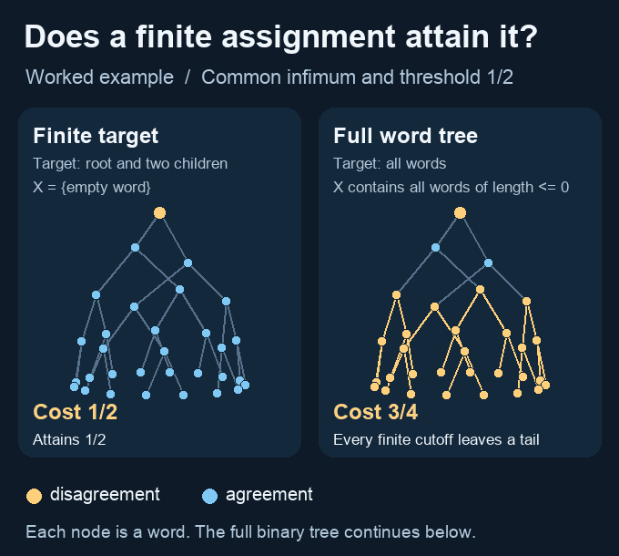

# Finite attainment for approximate language equations

Can finite languages be assigned to the variables of two expressions so that their discounted symmetric-difference distance is **at most** a given rational threshold?

**Result.** Yes, this is decidable for finite language constants, Boolean operations and left concatenation by finite constants. The algorithm compares the exact $d_2$ infimum with the threshold. If they are equal, it decides whether a finite assignment actually attains that infimum.

[Paper PDF](paper/manuscript.pdf) · [LaTeX source](paper/manuscript.tex) · [Catalog Q311](https://github.com/10m-u/open-problems-catalog/blob/ca8d4d44ba3db527f19f28928c240168f545ecfe/problems/mathematics/logic-foundations-set-theory-part-1.md#q311) · [Marantidis §6.4](https://lat.inf.tu-dresden.de/research/theses/2019/Marantidis-Diss-2019.pdf#page=117)

## Same infimum, different answer

Compare $\{a,b\}\cdot X$ with two targets. The empty word is always a disagreement and contributes $1/2$. With target $\{\epsilon,a,b\}$, taking $X=\{\epsilon\}$ gives exactly $1/2$. With target $\Sigma^*$, every finite $X$ leaves some nonempty words in disagreement. Keeping all words through depth $h$ gives distance $1/2+2^{-h-2}$, so the infimum is $1/2$ even though the decision at that threshold is negative.

[Download the offline explorer ZIP](https://raw.githubusercontent.com/DannyExperiments/finite-language-distance-attainment/v1.0.0/visualization/finite-language-distance-attainment-explorer.zip) · [Worked example and rendering guide](visualization/README.md)

## Proof idea

Each word is a node of a tree. Its action records membership in the finitely many variables. Since every concatenation strips a bounded prefix, the current action and a bounded history suffice to tell whether the two expressions disagree at that node.

Marantidis already computed the infimum and proposed retaining optimal transitions to test finite attainment. The paper proves that the global excess over the infimum is a sum of nonnegative local gaps, with a positive weight at each node. Thus an optimal assignment uses only optimal actions. The finite-support test first finds states that can use zero forever, then adds states whose optimal action sends every child toward that set. [Prior work and exact scope](audits/public_safe_reports/LITERATURE_AUDIT.md)

## Replay and review

The replay checks exact infima and finite witnesses, compares the compiler with direct word membership, and exhaustively checks the attainment condition on 1,296 small controllers. [Reproduce the checks](REPRODUCIBILITY.md) · [Review status](STATUS.md) · [Claim scope](CLAIM_SCOPE_AND_LIMITATIONS.md)

DannyExperiments is the preferred citation identity. [Citation metadata](CITATION.cff) · [Research disclosure](AI_DISCLOSURE.md)

[Release v1.0.0](https://github.com/DannyExperiments/finite-language-distance-attainment/releases/tag/v1.0.0) · [Version DOI](https://doi.org/10.5281/zenodo.24569242) · [Citation](CITATION.cff)
